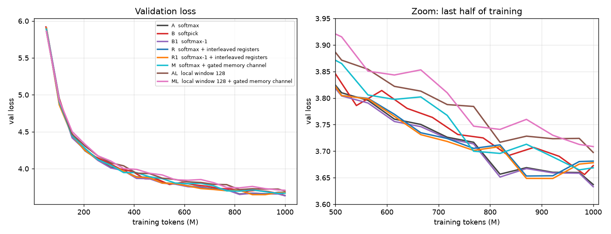
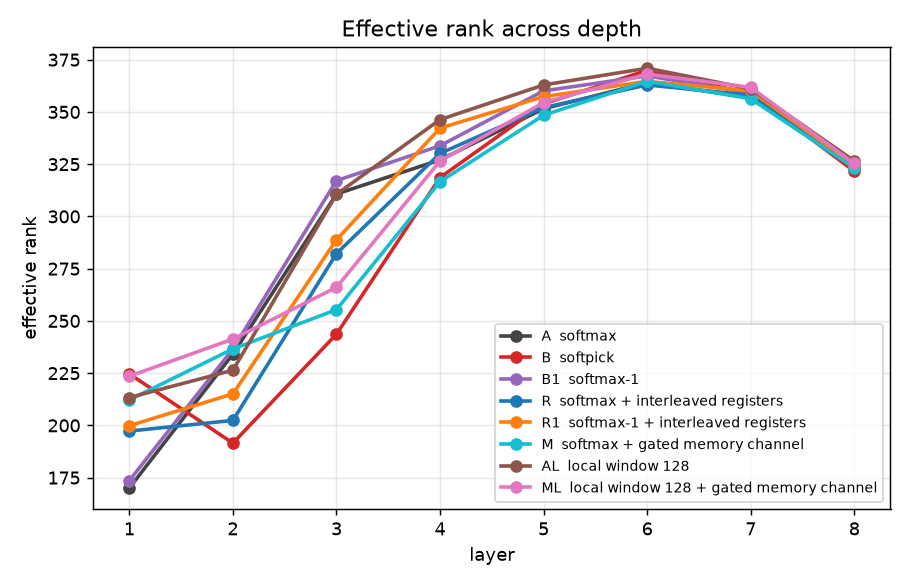
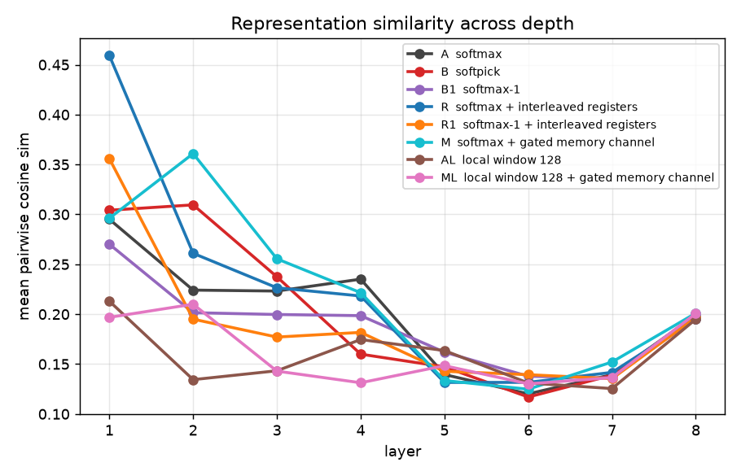
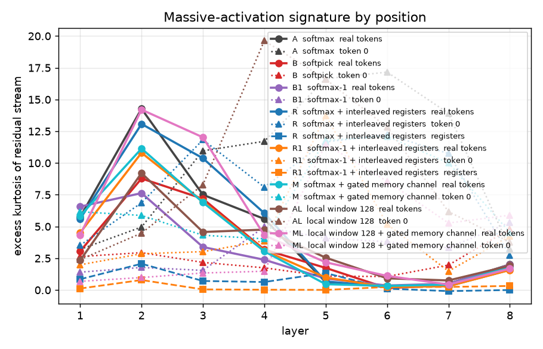
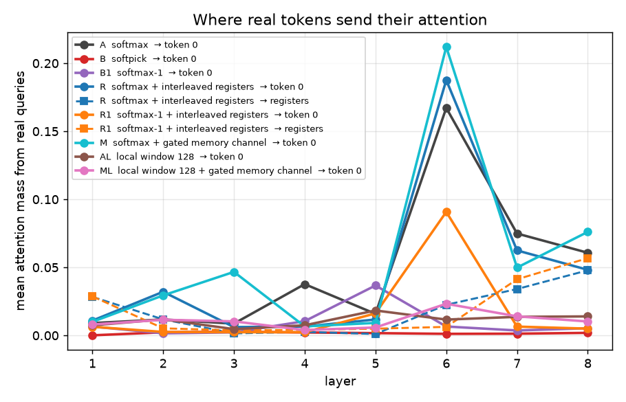
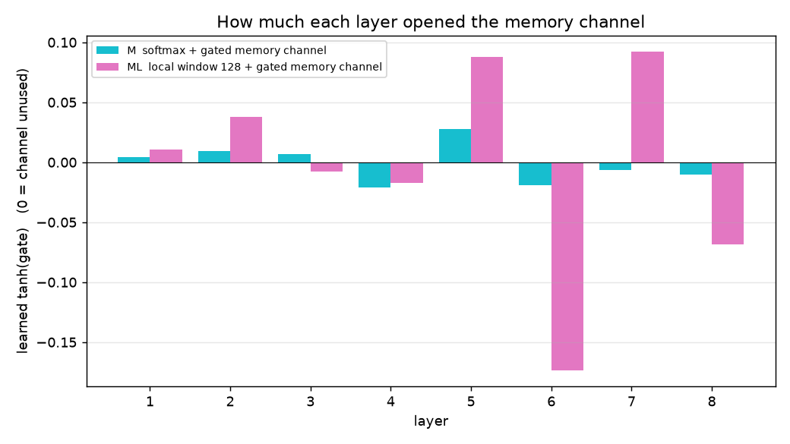
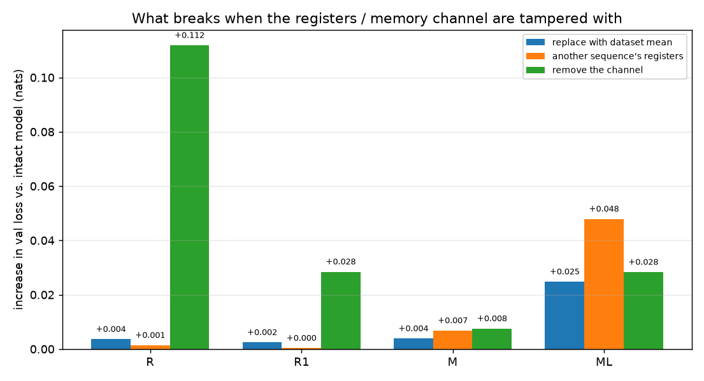

# Attention sinks vs. register tokens in a small causal LM

A controlled study of whether the attention sink is a softmax artifact, and whether a causal language model will use dedicated memory slots ("registers") if offered. 8 layers / 8 heads / d=512 / context 1024 / ~51M parameters (~68M with a memory channel), trained on 1B tokens of FineWeb-Edu (GPT-2 BPE), AdamW, peak LR 4e-4, bf16, seed 1337. **Single seed per arm.**

| Arm | What differs from the baseline |
|---|---|
| **A** | Baseline: vanilla causal softmax attention |
| **B** | Softpick attention (rectified, rows may sum to < 1; Zuhri et al. 2025) |
| **B1** | Softmax-1 ("off-by-one"): a free zero-logit slot so rows may sum to < 1 |
| **R** | A + 4 interleaved register tokens (each reads the context before it, is read by all later tokens, no LM-loss target) |
| **R1** | B1 + the same 4 interleaved registers |
| **M** | A + a dedicated gated write/read memory channel (below) |
| **AL** | A with self-attention limited to a 128-token local window |
| **ML** | AL + the same gated memory channel as M |

**Memory channel (M, ML).** Four register slots, each written by a learned query that cross-attends over the causal prefix up to a checkpoint (dedicated weights), and read by every later token through a second cross-attention (dedicated weights, plus an always-visible null slot). The read output enters the residual stream as `tanh(gate) * read`, with `gate` zero-initialised, so at step 0 the model is bit-for-bit identical to the baseline and the channel is *offered, not forced*. The learned `|tanh(gate)|` per layer is a direct measure of how much the model chose to use it (the sign is arbitrary: it can be absorbed into the projection weights).

## TL;DR

1. **The attention sink and massive activations are a softmax-forcing artifact at this scale.** Softpick (B) and softmax-1 (B1) both remove them (attention mass on token 0 ≈0.05 → ≤0.01; peak residual-stream kurtosis at token 0 17 → 5) with no representational collapse. Softmax-1 did so at no loss cost (final val 3.633 vs 3.637) and no extra compute (one extra key); softpick cost +0.036 nats.

2. **With full attention available, registers are not used for storage** (R, R1, M). The interleaved registers draw ~2% of attention and behave like a learned constant; in M the gates stay ≤ 0.03 in magnitude and no ablation costs more than 0.008 nats.

3. **When direct attention is cut off, the channel *is* recruited** (ML vs M): gates grow ~6× (max |gate| 0.17 vs 0.03), and the ablations show *sequence-specific* content flowing through the registers: handing the model another sequence's registers hurts more (+0.048) than removing the channel (+0.028) or replacing it with the dataset mean (+0.025). This is consistent with "no pressure to use it" being why M left it alone.

4. **Recruited is not the same as helpful.** ML's loss is no better than AL's (final val 3.709 vs 3.698; fixed-batch probe 3.775 vs 3.780: differences of opposite sign), so the channel did not recover the ~0.06–0.08 nats that the local window costs. Possible reasons, none tested here: four slots written at four fixed points are too narrow; the training budget is too short for the model to learn to exploit it; or a small gain is below what one seed can resolve.

## Headline numbers

Two validation numbers are given: **final val** is the end-of-training evaluation (40 random batches from the held-out split); **probe val** is a fixed 64-sequence batch shared by every probe. They differ in level but should be compared within a column.

| Arm | final val | probe val | mass→token0 | sink rate | mass→registers | kurtosis@token0 (max layer) | kurtosis@registers (max) | eff. rank (final) | cos sim (final) |
|---|---|---|---|---|---|---|---|---|---|
| A  softmax | 3.637 | 3.699 | 0.0482 | 0.031 | n/a | 17.2 | n/a | 323.7 | 0.199 |
| B  softpick | 3.673 | 3.716 | 0.0017 | 0.000 | n/a | 4.8 | n/a | 321.7 | 0.195 |
| B1  softmax-1 | 3.633 | 3.698 | 0.0091 | 0.000 | n/a | 5.3 | n/a | 323.9 | 0.200 |
| R  softmax + interleaved registers | 3.681 | 3.730 | 0.0457 | 0.031 | 0.0187 | 12.2 | 2.1 | 324.5 | 0.195 |
| R1  softmax-1 + interleaved registers | 3.678 | 3.715 | 0.0165 | 0.000 | 0.0189 | 13.7 | 0.8 | 324.7 | 0.197 |
| M  softmax + gated memory channel | 3.669 | 3.711 | 0.0550 | 0.031 | n/a | 12.1 | n/a | 323.2 | 0.201 |
| AL  local window 128 | 3.698 | 3.780 | 0.0111 | 0.000 | n/a | 19.6 | n/a | 326.5 | 0.195 |
| ML  local window 128 + gated memory channel | 3.709 | 3.775 | 0.0109 | 0.000 | n/a | 11.5 | n/a | 325.4 | 0.201 |

## Representational collapse

Higher effective rank / lower cosine similarity = representations stay spread across depth.

| Arm | eff. rank final | eff. rank mean | cos sim final | cos sim mean | resid norm (real) |
|---|---|---|---|---|---|
| A  softmax | 323.7 | 304.8 | 0.199 | 0.197 | 12.76 |
| B  softpick | 321.7 | 297.8 | 0.195 | 0.201 | 13.78 |
| B1  softmax-1 | 323.9 | 308.9 | 0.200 | 0.188 | 12.80 |
| R  softmax + interleaved registers | 324.5 | 301.2 | 0.195 | 0.221 | 13.54 |
| R1  softmax-1 + interleaved registers | 324.7 | 306.6 | 0.197 | 0.190 | 13.24 |
| M  softmax + gated memory channel | 323.2 | 301.7 | 0.201 | 0.218 | 12.82 |
| AL  local window 128 | 326.5 | 314.8 | 0.195 | 0.160 | 13.43 |
| ML  local window 128 + gated memory channel | 325.4 | 308.4 | 0.201 | 0.162 | 13.18 |

## Massive activations

| Arm | kurt@token0 (max) | kurt real (mean) | kurt registers (max) | max abs act @token0 | max abs act real | max abs act registers |
|---|---|---|---|---|---|---|
| A  softmax | 17.2 | 4.6 | n/a | 33.2 | 2.9 | n/a |
| B  softpick | 4.8 | 3.3 | n/a | 7.6 | 3.0 | n/a |
| B1  softmax-1 | 5.3 | 3.0 | n/a | 6.8 | 2.6 | n/a |
| R  softmax + interleaved registers | 12.2 | 4.7 | 2.1 | 28.9 | 3.0 | 8.4 |
| R1  softmax-1 + interleaved registers | 13.7 | 3.6 | 0.8 | 19.8 | 2.8 | 7.0 |
| M  softmax + gated memory channel | 12.1 | 3.7 | n/a | 32.7 | 2.8 | n/a |
| AL  local window 128 | 19.6 | 3.4 | n/a | 16.0 | 2.9 | n/a |
| ML  local window 128 + gated memory channel | 11.5 | 5.0 | n/a | 14.4 | 3.0 | n/a |

## Gated write/read memory channel (arms M and ML)

Dedicated cross-attention write (register queries the causal prefix) and read (real tokens query the registers), added on top of an otherwise unchanged self-attention stack (A's for M, AL's for ML). `tanh(gate)` scales the read output added to the residual and starts at exactly 0 (offered, not forced) — its learned value is the direct usage signal, not a proxy.

| Arm | probe val | max abs gate | mass→registers (all / steady-state) | mass→phantom | kurtosis (registers) | norm (registers vs real) |
|---|---|---|---|---|---|---|
| M  softmax + gated memory channel | 3.711 | 0.0280 | 0.350 / 0.525 | 0.650 | 0.54 | 7.7 vs 12.8 |
| ML  local window 128 + gated memory channel | 3.775 | 0.1735 | 0.279 / 0.406 | 0.721 | 0.19 | 10.3 vs 13.2 |

- **M  softmax + gated memory channel gate by layer:** +0.0043, +0.0096, +0.0068, -0.0213, +0.0280, -0.0190, -0.0062, -0.0104
- **ML  local window 128 + gated memory channel gate by layer:** +0.0105, +0.0377, -0.0076, -0.0171, +0.0878, -0.1735, +0.0921, -0.0682

## Causal ablation of the registers / memory channel

`mean` = replace this sequence's register content with the eval-set mean · `zero` = remove the channel entirely (for arm M: gate forced to 0, the built-in ablation) · `shuffle` = use a different sequence's registers. A val-loss jump on `mean` or `shuffle` specifically ⇒ per-context information; a jump on `zero` alone ⇒ a context-independent learned constant.

| Arm | intact | mean-ablate (Δ) | zero-ablate (Δ) | shuffle (Δ) | eff.rank intact→mean |
|---|---|---|---|---|---|
| R  softmax + interleaved registers | 3.730 | 3.733 (+0.004) | 3.842 (+0.112) | 3.731 (+0.001) | 324.5→323.7 |
| R1  softmax-1 + interleaved registers | 3.715 | 3.718 (+0.002) | 3.744 (+0.028) | 3.716 (+0.000) | 324.7→324.5 |
| M  softmax + gated memory channel | 3.711 | 3.715 (+0.004) | 3.719 (+0.008) | 3.718 (+0.007) | 323.2→322.9 |
| ML  local window 128 + gated memory channel | 3.775 | 3.800 (+0.025) | 3.803 (+0.028) | 3.823 (+0.048) | 325.4→328.8 |

## Figures

## The forcing test: does cutting off direct attention make the model use memory?

Arms are paired: M/A have full causal attention; ML/AL have a 128-token local window. The memory channel is the only way information older than 128 tokens can reach a token in ML.

| Arm | window | memory | final val | Σ gate | max gate | Δ mean-ablate | Δ shuffle-ablate | Δ remove channel |
|---|---|---|---|---|---|---|---|---|
| A  softmax | full | no | 3.637 | n/a | n/a | n/a | n/a | n/a |
| M  softmax + gated memory channel | full | yes | 3.669 | 0.106 | 0.028 | +0.004 | +0.007 | +0.008 |
| AL  local window 128 | 128 | no | 3.698 | n/a | n/a | n/a | n/a | n/a |
| ML  local window 128 + gated memory channel | 128 | yes | 3.709 | 0.495 | 0.174 | +0.025 | +0.048 | +0.028 |

- **Cost of the local window:** AL − A = +0.060 nats (final val), so there is long-range information the model wants and cannot reach directly.
- **Does the channel recover it?** ML − AL = +0.011 nats (final val). It does not: the channel is used but gives no net loss improvement here.
- **What flows through it in ML:** swapping in another sequence's registers costs +0.048, more than removing the channel (+0.028) or using the dataset-mean registers (+0.025). Wrong-sequence content being worse than no content is the signature of sequence-specific information, not a learned constant. In M, all three are ≤ 0.008.
- **How it reads:** ML's read attention puts 28% of its weight on the registers (41% where all four are visible) and 72% on the null slot; register contents have no outlier signature (max kurtosis 0.19) and a *lower* norm than ordinary tokens (10.3 vs 13.2).

## Caveats

- **One seed per arm.** The effects reported as differences of a few hundredths of a nat (all the ablation deltas, and ML vs AL) have no error bars. An earlier ML run that was interrupted by hardware crashes at step 3500 followed a near-identical gate trajectory (Σ|gate| 0.25 vs 0.24 at that step), but it used the same seed, so it is a reproducibility check, not an independent replicate.
- **Small scale** (~51M parameters, 8 layers, 1B tokens, context 1024). Sink strength and the benefit of memory may change with depth and scale.
- **No beginning-of-sequence token.** Training windows are random 1024-token crops, so the sink here is positional, not tied to a special token.
- **The memory channel is narrow by design** (4 slots, 4 write checkpoints, one read cross-attention per layer). A null result for this design says little about wider or recurrent memories.
- Effective rank and cosine similarity show no collapse in any arm; they are computed on the final residual stream of the real tokens.
- Training settings were fixed after instabilities in the first softpick attempts (fp32 normalisation with a detached max-pivot and a floored denominator; peak LR lowered from 6e-4 to 4e-4 for *all* arms, and the baseline re-run to match).
